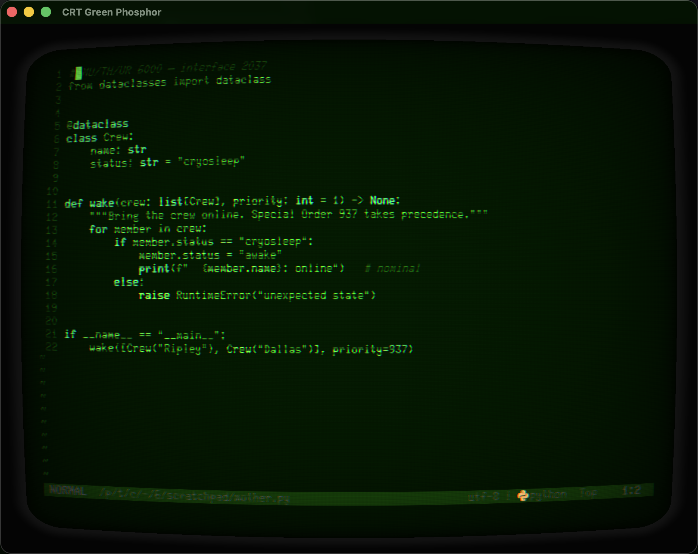

# Guide — demos, install detail, boot system, customization

The short version lives in the [README](README.md); machine lists in
[MACHINES.md](MACHINES.md); Ghostty depth in [GHOSTTY.md](GHOSTTY.md).

## Live demo & tours

To tour the profiles as real terminal windows instead of browser previews:

```bash
tools/retro-demo                         # detect iTerm2 / Ghostty and ask
tools/retro-demo --terminal ghostty      # force one backend
tools/retro-demo --group sci-fi          # tour one collection
tools/retro-demo --delay 8 --shuffle     # unattended slideshow
tools/retro-demo --group retro --limit 3 # a short sampler
tools/retro-demo --manifest              # inspect the launch plan only
```

```bash
tools/retro-random                     # any of the 47
tools/retro-random --group sci-fi      # one pack
tools/retro-random --terminal ghostty  # Ghostty instead of iTerm2
retro launch [group]                   # the same thing from the shell
```

**Random default, not random window.** `tools/retro-default` rolls a machine
and makes it the terminal's *default* profile, so plain ⌘N and every window at
launch wears it, until the next roll:

```bash
tools/retro-default                     # roll now: Ghostty + iTerm2
tools/retro-default --group corpo       # one pack; --terminal ghostty for one app
tools/retro-default --print             # see the roll, change nothing
tools/retro-default --install-login     # LaunchAgent: re-roll at every login/reboot
tools/retro-default --uninstall-login
```

Ghostty gets a fenced `config-file = retro/<slug>` block in
`~/.config/ghostty/config` (your other lines survive; ⌘⇧, to reload). iTerm2
gets its `Default Bookmark Guid` pref, read at next launch. It never re-rolls
the machine already worn.

`retro random` repaints the window you are already in
(palette, prompt, banner) and cannot carry a font, because the cell grid is
fixed when a window is created and no escape sequence changes it. `retro
launch` / `retro-random` create the window instead, so the machine arrives
whole. Or wire it into iTerm2 itself:

```bash
integration/iterm2/install.sh                  # menu entry + AutoLaunch
integration/iterm2/install.sh --no-autolaunch  # menu entry only
```

That adds **Scripts ▸ Random Retro Terminal** to the menu bar and fires one at
every iTerm2 launch. The installer asks iTerm2 where its scripts folder *is*
(`CustomScriptsFolder`) rather than assuming the documented default — a custom
folder is set in a pref key, not on disk, so installing to the default when one
is set fails silently: the file compiles, runs by hand, and is never read.

The controller opens one disposable window at a time. Press Enter in the
controller to close that exact window and advance (`b` goes back, `q` quits).
It tracks iTerm2 by window ID and Ghostty by spawned process, so existing user
windows are never closed. Ghostty requires generated configs from
`python3 build_ghostty.py`; iTerm2 requires the profiles from `./install.sh`.
Demo Ghostty instances are pinned to an 80×25 grid and opt out of macOS window
restoration, preventing font-specific profiles from inheriting oversized state.

## Install (build them into your iTerm2)

```bash
./install.sh              # fetch fonts + build all profiles into iTerm2
./install.sh --no-fonts   # profiles only (fonts already present)
```

Under the hood the profiles are built by one script:

```bash
python3 build_profiles.py
```

It writes four JSON files into `~/Library/Application Support/iTerm2/DynamicProfiles/`,
which iTerm2 **watches and hot-loads live** — no restart. Re-run it any time you
edit a palette; open tabs restyle within a second. Then in iTerm2 press **⌘O** and
filter by tag (`retro` / `sci-fi` / `aesthetic` / `corpo`).

## Visual gallery & CRT playground

- **Gallery** — every profile rendered in its real font:
  <https://giantravens.github.io/retro-terminals/>
- **CRT playground** — a WebGL curved-glass shader (the effect iTerm can't do
  natively): <https://giantravens.github.io/retro-terminals/crt-playground.html>

## How it works

`build_profiles.py` holds a compact `PROFILES` spec — each machine is a set of
`#RRGGBB` hex colors plus a few settings (font, cursor, blink, glow). The script
compiles that into iTerm2's verbose float-based JSON and writes it to:

```
~/Library/Application Support/iTerm2/DynamicProfiles/retro-terminals.json
```

iTerm2 **watches that folder and hot-loads changes live** — no restart, no
manual import. The profiles appear in the profile switcher (`⌘⇧O`) tagged
`retro`.

GUIDs are derived deterministically from each profile name (`uuid5`), so
re-running the script **updates profiles in place** instead of creating
duplicates. Never hand-edit a `Guid`; in iTerm2 it's the profile's identity.

## Using a profile

- Browse: **Profiles** menu, or `⌘⇧O` and filter by `retro`.
- New tab in a profile: **Profiles ▸ Retro · …**.
- Make one your default: iTerm2 ▸ Settings ▸ Profiles ▸ select ▸ **Other Actions ▸ Set as Default**.

## Tweaking

Edit the hex values in `build_profiles.py`, then:

```bash
python3 build_profiles.py
```

The open tabs restyle within a second. Useful knobs per machine:

- `cursor_type`: `UNDERLINE` / `VBAR` / `BOX`
- `blink`: blinking cursor
- `aa`: anti-aliasing — **False** keeps bitmap fonts (C64, Terminus, Glass TTY,
  3270, Departure) crisp; **True** for outline fonts (Courier, Menlo)
- `transparency`, `blur`, `blur_radius`: the CRT glow approximation
- `min_contrast`: floor on text/background contrast (bump for readability)
- `vspacing` / `hspacing`: line/char spacing. `vspacing` multiplies a per-font
  baseline (`FONT_LEADING`) that already compensates for the zero-leading
  character-ROM fonts — so `1.05` always means "5% extra," whatever the font
  (a hair of it fakes scanline gaps)
- `symbols`: Nerd Font fallback for non-ASCII (file icons in Neo-tree, lualine,
  any TUI). On by default; the builder sizes `SymbolsNFM` to the machine font's
  measured cell width (`FONT_CELL_EM`) so icons stay inside one cell

Everything about a machine's boot is plain-text data you can edit:

| File | What it is |
|---|---|
| `banners/<key>.txt` | the big ASCII art + its colors (`#:` header: `bg`, `base`, `frame`, `paint <hex> <glyphs>`, `line <n> <hex>` for stripes) |
| `banners/<key>.boot` | the typed chatter (`#: cps <n>`, then lines; `@sleep`, `@bell`, `@art`, `@print` directives; legacy sound metadata is ignored) |
| `~/.config/retro-terminals/banners/<key>.txt` | **your art override** — wins over the shipped file |
| `~/.config/retro-terminals/boot/<key>.boot` | **your chatter override** |
| `~/.config/retro-terminals/boot/<key>.sh` | full takeover: your script replaces the whole presentation |
| `~/.config/retro-terminals/fonts.local` | **your font override** — repoint any machine at a face you own |

**Banner-art generators.** Two tools produce banner-ready glyph art:

```bash
# any image -> bare glyphs (no ANSI), ready to paste under #: directives
tools/image-to-ascii.py logo.png --mode braille --plain --trim -w 44
tools/image-to-ascii.py logo.png --mode braille --plain --invert -t 72   # light-on-dark source
tools/image-to-ascii.py photo.png --mode ansi --tint 0,220,255           # standalone colored art

# parametric atom diagram (atompunk) - geometry as tunable numbers
tools/atom-diagram.py
```

`image-to-ascii.py` samples an image through ImageMagick (`brew install
imagemagick`); braille mode packs 2x4 square subpixels per cell, the smoothest
of its four modes. `--plain` emits bare glyphs so `retro-banner` keeps doing
the painting; `--invert` flips ink polarity for light-on-dark sources; `-t`
sets the luminance cutoff (e.g. keep a logo's yellow but drop its gray).
`atom-diagram.py` renders the atompunk orbital diagram from ellipse equations
instead of pixels — orbits in braille, nucleus as `▓` and electrons as `●` so
glyph-keyed paint rules can color them independently. The winged-W in
`mother`/`muthur` and the atom in `atompunk` came from these.

**Sound.** Boot presentations are intentionally silent. Legacy `#: sound` and
`@bell` directives remain accepted as no-ops so existing chatter overrides do
not break; sound design can return later as an intentional, opt-in system.

Knobs (env, all optional):

| Toggle | Effect |
|---|---|
| `RETRO_BOOT=0` | skip the whole presentation, straight to the shell |
| `RETRO_BOOT_WAIT=1` | hold on a blinking `▸ PRESS ENTER ▸` gate after the art (default: a short beat, then straight on) |
| `RETRO_BOOT_CPS=n` | typing speed override |
| `RETRO_BOOT_THROTTLE=120` | within N seconds of the last boot of the same machine (split pane, rapid new tab) show the **quick** version — instant art, no typing, no gate. `0` = full ceremony every time |

## Matching prompts — the `retro` command

Because this box runs **tmux + starship**, a prompt set at profile-open gets
overwritten by starship's `precmd` hook, and `ITERM_PROFILE` is stale inside
tmux. So prompts are a command you run, not per-profile magic:

```bash
source /path/to/retro-terminals/retro-prompts.zsh   # once (or add to ~/.zshrc)
retro c64      # READY.        retro amiga   # 1>
retro dos      # C:\>          retro irix    # indy 1%
retro apple2   # ]             retro off     # back to starship
retro          # list them
```

`retro` removes starship's hook while active and restores it on `retro off`, so
it works in any shell, in or out of tmux.

## Scanline bezel (real iTerm2)

The five "tube" profiles — Green, Amber, Apple II, C64, BBC — carry
`crt-bezel.png`, a mostly-transparent scanline + vignette overlay drawn behind
the text. Tune its strength per profile with **Settings ▸ Profiles ▸ Window ▸
Background image ▸ Blend** (the generator sets `Blend` to `0.47`). Regenerate the
overlay itself with ImageMagick if you want it heavier/finer — the two `magick`
lines are in the project history. This nudges real iTerm toward the browser
playground's look; it's texture, not the full curved-glass shader.

## Ghostty — the real CRT shader

> **Runbook:** [`GHOSTTY.md`](GHOSTTY.md) — build, launch, tune, publish, and the
> tmux opt-in, command-first in one place.

iTerm2 has no shader pipeline, so its "CRT" is the bezel PNG plus blur. Ghostty
renders on the GPU and takes a **custom GLSL shader**, so the same palettes get
actual curved glass. `build_ghostty.py` imports the `PROFILES` spec from
`build_profiles.py` and compiles it into `~/.config/ghostty/`:

```bash
python3 build_ghostty.py            # write into ~/.config/ghostty
python3 build_ghostty.py --stdout   # preview one config, write nothing
python3 build_ghostty.py --dest DIR # write somewhere else
```

It emits:

- `themes/<slug>` — colors only. Drop into an existing setup with
  `theme = <slug>` in your config, or browse with `ghostty +list-themes`.
- `retro/<slug>` — a fully self-contained config (colors + font + window +
  shader). Launch a styled window:
  `ghostty --config-file=~/.config/ghostty/retro/<slug>`.
- `shaders/crt.glsl` — the CRT fragment shader (`shaders/crt.glsl` in this
  repo), attached to the same 21 "tube" machines that got the iTerm2 bezel.
- `retro/aliases.sh` — a `ghostty-<name>` launcher per profile, cross-platform
  (macOS `open`, Linux/BSD `ghostty`; picked at runtime via `uname`). `source`
  it from your `~/.zshrc`.

```bash
brew install --cask ghostty        # if you don't have it yet
source ~/.config/ghostty/retro/aliases.sh
ghostty-mu-th-ur-6000-crt          # MOTHER, on curved glass
```

Tweak the shader constants (`CURVATURE`, `SCANLINE`, `BLOOM`, `FLICKER`, …) at
the top of `shaders/crt.glsl` — Ghostty hot-reloads shaders when the window
regains focus.

**Mapping caveats** (where the two backends can't be identical):

- Transparency is inverted (iTerm2 `0` = opaque; Ghostty `background-opacity 1`
  = opaque) — the builder handles it.
- iTerm2's blur *radius* has no Ghostty analog → `background-blur = true`.
- Bitmap/pixel fonts render soft: Ghostty has no "anti-aliasing off" toggle, so
  C64 / Terminus / Glass TTY / 3270 / Departure lose the crisp-pixel look.
- Minimum Contrast, Bright-Bold, Link Color: no clean Ghostty equivalent →
  dropped. (Boot banners DO carry over — the `ghostty-*` launchers stash the
  machine key and the shell runs the same `tools/retro-boot` presentation.)
- `bold-color` needs Ghostty ≥ 1.1; older builds log "unknown field" and skip it.

iTerm2 stays the recommended daily driver (scrollback + logging). Ghostty is the
"fun" terminal you open when you want the real tube.

## Ghostty Studio — browse, tune, publish

`ghostty-studio.html` is a self-contained page that closes the loop: **browse**
all 47 palettes, **tune** the CRT live, and **publish** the result straight back
into `~/.config/ghostty`.

```bash
python3 build_ghostty.py --studio    # regenerate the page from the SPEC
open ghostty-studio.html
```

- **Browse** — every machine, grouped by pack, with a live terminal preview in
  its real font and palette. Tube machines are tagged `CRT`.
- **Tune** — nine dials that *are* the constants in `shaders/crt.glsl`
  (curvature, scanlines, aperture grille, aberration, bloom, flicker,
  brightness, bezel inset, corner radius), plus a per-profile **screen padding**
  dial. The preview runs the identical WebGL math, so what you see is what
  Ghostty draws. Toggle **CRT** on any profile to preview/publish the shader.
- **Publish** — copy the **publish command** and paste it in your terminal. It
  writes `retro/<slug>` (and the shared `crt.glsl` if CRT is on) and **opens a
  new window wearing the profile**. A running window keeps the look it was
  launched with, so publishing hands you a fresh one rather than repainting it.
  Nothing is written until you paste — the browser can't touch your files, so
  the tool hands you a shell command instead.

Single-sourced like everything else: the page is filled from `build_profiles.py`
via `tools/studio-template.html`, so it never drifts from the palettes. Edit a
color, re-run `--studio`, reload the page. The CRT dials tune the *shared*
`crt.glsl` — one shader for all tubes — so publishing it updates every tube;
`screen padding` is per-profile and rewrites that profile's `window-padding`.

## Following the theme — starship, tmux, nvim

ANSI palette slots **0–15 follow the active profile; the 256-cube (16–255) and
`#hex` are fixed**. So anything drawn with a slot 0–15 (or an ANSI *name* like
`green`) re-colors automatically when you switch profiles — the same trick that
makes the whole palette swap live. A program can't know *which* named profile is
active, but it doesn't need to: draw from slots and it wears whatever the window
is using.

> Paths below use `/path/to/retro-terminals` — substitute wherever you cloned
> this repo.

- **Starship already follows.** `starship.toml` styles with `green` / `yellow`
  / `cyan` / `purple` — ANSI names → slots 2/3/6/5. Open any profile and the
  prompt is already wearing its colors. (Monochrome tubes render a monochrome
  prompt — authentic.)
- **tmux doesn't, by default.** The stock airline footer pins `colour236` /
  `colour31` / `colour214` (all ≥ 16, fixed), so it looks identical everywhere.
  `integration/tmux-retro-status.conf` redraws the whole tmux surface — status
  bar, window tabs, pane borders, copy mode and clock — from slots 0–15, so it
  tracks the profile. Enable by sourcing it *after* your own status block:

  ```bash
  source-file /path/to/retro-terminals/integration/tmux-retro-status.conf
  ```

  On a multi-machine setup, put that line in a non-synced machine-local include
  (many configs already source `~/.tmux.conf.local` at the end), then
  `tmux source-file ~/.tmux.conf`. Delete the line to revert. In Ghostty the
  same file works — the CRT shader tints the footer along with everything else.
- **nvim doesn't either** — modern colorschemes set `termguicolors` and bake
  24-bit hex, bypassing the ANSI palette entirely. `integration/nvim` is a tiny
  plugin — a `retro-ansi` colorscheme (turns `termguicolors` off, paints every
  highlight group from slots 0–15) plus a **`:Retro`** command. The editor then
  wears whichever profile the window has (green-phosphor window → monochrome-
  green nvim; C64 → C64):

  

  Point your runtimepath at it — with lazy.nvim:

  ```lua
  { dir = vim.fn.expand("/path/to/retro-terminals/integration/nvim"),
    name = "retro-ansi", lazy = false, priority = 900 }
  ```

  or without a plugin manager:

  ```lua
  local d = vim.fn.expand("/path/to/retro-terminals/integration/nvim")
  vim.opt.rtp:append(d)                     -- expose colors/retro-ansi.lua
  vim.cmd.source(d .. "/plugin/retro.lua")  -- define :Retro
  ```

  Then **`:Retro`** in a retro window: it saves your current scheme, switches to
  `retro-ansi` (16-color mode), and `:Retro` again restores exactly what you had.
  It's a mode you toggle into, since following the palette needs 16-color mode.

  **File icons** (Neo-tree, devicons) work out of the box: the retro fonts are
  character-ROM conversions with no icon glyphs, so every iTerm2 profile carries
  a Symbols Nerd Font fallback for non-ASCII, sized to the machine font's cell
  width (Ghostty ships its own fallback natively). Prefer a terminal that never
  drew a folder in its life? `require("retro.icons").neotree` is an opt-in
  Neo-tree opts fragment with pure-ASCII `+`/`-` folders and single-letter git
  symbols — usage in `integration/nvim/lua/retro/icons.lua`.

## Window titles

Both backends pin the **machine name** in the window/tab title by default, so a
screen full of tubes is easy to tell apart:

- **iTerm2** (`build_profiles.py`) sets each profile's *Profile Name* title
  component (`Title Components = 32`). The shell can rename the *session* but not
  the *profile*, so the machine name stays put under tmux/starship/boot banners.
- **Ghostty** (`build_ghostty.py`) writes a static `title = <name>` into each
  config. Static means it *replaces* the dynamic dir/command title.

Pass `--no-titles` to either builder to keep dynamic titles instead.

## Fonts & provenance

Installed to `~/Library/Fonts` (all free):

- **Glass TTY VT220** — Viacheslav Slavinsky, `sensi.org/~svo/glasstty` (free)
- **C64 Pro Mono** — Style, `style64.org` (free for personal use)
- **Print Char 21** — Kreative Korp, `kreativekorp.com` (Apple ][ system font, free)
- **Bedstead** — bjh21, `bjh21.me.uk/bedstead` (SAA5050 teletext, public domain)
- **Terminus (TTF)** — `brew install --cask font-terminus` (OFL)
- **IBM 3270** — `brew install --cask font-3270` (OFL)
- **Departure Mono** — `brew install --cask font-departure-mono` (OFL)
- **Symbols Nerd Font Mono** — `brew install --cask font-symbols-only-nerd-font`
  (MIT) — icons-only non-ASCII fallback (nvim devicons etc.), all profiles
- **Courier / Menlo** — macOS system fonts

## Notes on fidelity

iTerm2 has no CRT-shader support, so the green/amber tubes approximate the glow
with transparency + Gaussian blur + a brighter bold color and a touch of extra
line spacing. It reads as "phosphor," not as a curved-glass emulator.

For the full curvature/scanline treatment you have two paths off iTerm2: the
**Ghostty port** in this repo (`build_ghostty.py`, real GLSL shader, keeps your
exact palettes) or a dedicated emulator like **cool-retro-term** (the whole app
*is* the CRT). The iTerm2 profiles stay real sessions you can actually work in;
Ghostty is where the tube gets genuinely curved.

---

Now go make your terminal look like it belongs on a starship. `READY.`
 ▮

