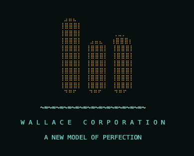
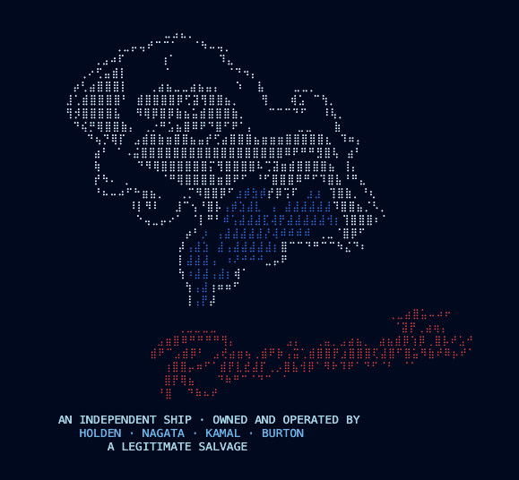
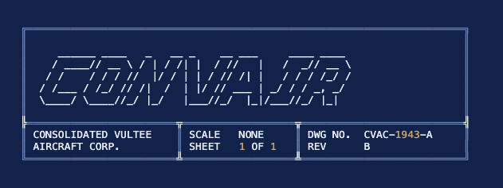
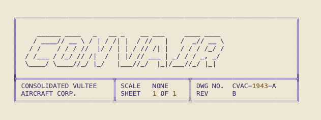

# Retro Terminals

**47 retro terminal recreations for iTerm2, Ghostty & nvim.** Real machines
and imagined ones with optional CRT effect in Ghostty, custom fonts, and logo to ascii conversion tools to built your own variations. 

**Test-drive the palettes in the
[Ghostty Studio](https://giantravens.github.io/retro-terminals/ghostty-studio.html)
· see every boot screen in the
[banner gallery](https://giantravens.github.io/retro-terminals/banners.html).**

| | |
|---|---|
|  |  |
|  |  |

*Wallace Corporation, the Rocinante's nose art, and the two Convair drafting
sheets — every machine boots with a screen like these.*

## The machines

- **`retro`** — Paper Teletype, CRT Green Phosphor, CRT Amber Phosphor, Linux Console, SunOS cmdtool, IRIX wsh, Commodore 64, MS-DOS Editor, Amiga Workbench, NeXTSTEP, OpenStep, Apple II, ZX Spectrum, Atari 8-bit, BBC Micro Mode 7, Plan 9 acme, Convair Blueprint, Convair Whiteprint
- **`sci-fi`** — The Matrix, TRON, Neuromancer, HAL 9000, Fallout Pip-Boy, Cyberpunk 2077, Blade Runner, WOPR, LCARS, Empire, Prime Radiant, Rocinante, MCRN, MU-TH-UR 6000, MU-TH-UR 6000 CRT, Nostromo, Nostromo CRT
- **`aesthetic`** — Outrun, Steampunk, Solarpunk, Dieselpunk, Vaporwave, Atompunk
- **`corpo`** — Weyland-Yutani, Seegson APOLLO, Tyrell Corporation, Wallace Corporation, Voight-Kampff, Severance Lumon

Palette swatches, fonts, and which machines boot with logo art:
[MACHINES.md](MACHINES.md).

## Quick start

```bash
./install.sh                 # iTerm2: fetch fonts + build all 47 profiles (hot-loads live)
python3 build_ghostty.py     # Ghostty: themes, configs, and the real CRT shader
tools/retro-demo             # tour them as real terminal windows
tools/retro-random           # or just wear one at random
tools/retro-default          # make a random one the DEFAULT profile (⌘N)
tools/retro-default --install-login   # ...and re-roll at every login
```

Then in iTerm2 press **⌘O** and filter by pack (`retro` / `sci-fi` /
`aesthetic` / `corpo`).

## Go deeper

- **[GUIDE.md](GUIDE.md)** — tours and integrations, how the build works,
  tweaking palettes, the boot-banner system and its logo-art generators,
  prompts, bezels, fonts and provenance
- **[GHOSTTY.md](GHOSTTY.md)** — the GPU CRT shader, per-machine configs,
  live recolor
- **[Profile gallery](https://giantravens.github.io/retro-terminals/)** and
  **[CRT playground](https://giantravens.github.io/retro-terminals/crt-playground.html)**
  on the live site

Fonts are fetched by `./install.sh`; OFL/public-domain faces are embedded in
the web gallery, the rest need a local install (provenance in GUIDE.md).
MIT licensed.
