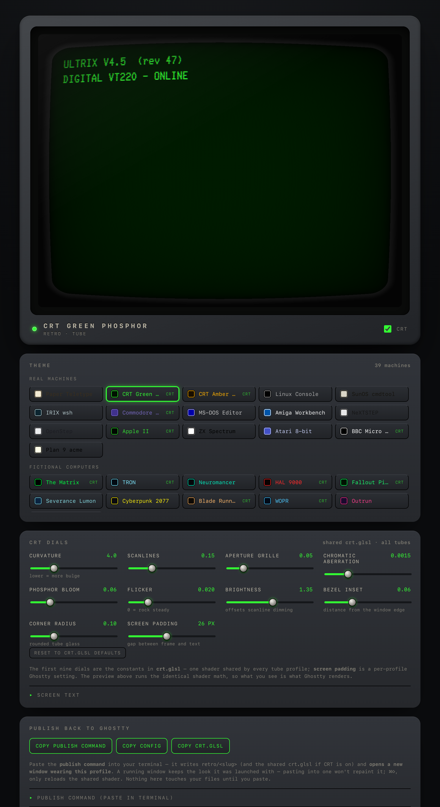

# Retro Terminals — retro themes for iTerm2, Ghostty & nvim

*Boot your terminal like it's 1983.* Phosphor that glows, a `READY.` that means
it, HAL watching from the title bar — **47 machines, real and imagined**, that
your terminal *and editor* can wear. On Ghostty the glass actually curves.

[](https://giantravens.github.io/retro-terminals/ghostty-studio.html)

**47 retro terminal themes** — real historic machines (`retro`: VT220 green
phosphor, C64, Amiga…), fictional computers (`sci-fi`: HAL, TRON, Pip-Boy…),
aesthetic movements (`aesthetic`: vaporwave, steampunk…), and the Alien/Blade
Runner megacorps plus Lumon (`corpo`) — for **iTerm2 or Ghostty**, driven from one
declarative palette spec:

- **iTerm2** (`build_profiles.py`) — the daily driver. 47 Dynamic Profiles,
  boot banners, matching prompts, and a static scanline bezel. Unlimited
  scrollback and session logging. The CRT look is *faked* (blur + bright bold).
- **Ghostty** (`build_ghostty.py`) — the same 47 palettes as Ghostty themes and
  configs, plus a **real GPU CRT shader** (curvature, scanlines, chromatic
  aberration, bloom) on the 21 "tube" machines. The effect iTerm2 can't do.

And it doesn't stop at the terminal window: **nvim follows the theme too** (a
`retro-ansi` colorscheme + `:Retro` toggle), and so do **tmux** and **starship**
— so your whole workspace wears the machine, editor and all. Pick a green tube
and the terminal, status bar, prompt, and editor all go phosphor green.

The palettes live in `build_profiles.py`; the Ghostty builder **imports** that
spec rather than copying it, so nothing drifts. Edit a hex value once, rebuild.


### ▶ See it live

- **[Profile gallery](https://giantravens.github.io/retro-terminals/)** — every machine in its real font
- **[Boot banners](https://giantravens.github.io/retro-terminals/banners.html)** — all 47 startup screens, braille logo art included
- **[CRT playground](https://giantravens.github.io/retro-terminals/crt-playground.html)** — live WebGL curved glass
- **[Ghostty Studio](https://giantravens.github.io/retro-terminals/ghostty-studio.html)** — browse, tune the CRT, publish a profile

## Quick start

```bash
./install.sh                 # iTerm2: fetch fonts + build all 47 profiles (hot-loads live)
python3 build_ghostty.py     # Ghostty: themes, configs, and the real CRT shader
tools/retro-demo             # tour them as real terminal windows
tools/retro-random           # or just wear one at random
```

Then in iTerm2 press **⌘O** and filter by pack (`retro` / `sci-fi` /
`aesthetic` / `corpo`).

## Go deeper

- **[MACHINES.md](MACHINES.md)** — every machine, every pack, and which ones
  boot with logo art
- **[GUIDE.md](GUIDE.md)** — tours and integrations, how the build works,
  tweaking palettes, the boot-banner system and its art generators, prompts,
  bezels, fonts and provenance
- **[GHOSTTY.md](GHOSTTY.md)** — the GPU CRT shader, per-machine configs,
  live recolor

Fonts are fetched by `./install.sh`; the OFL/public-domain faces are embedded
in the web gallery, the rest need a local install (see GUIDE.md for
provenance). MIT licensed.
